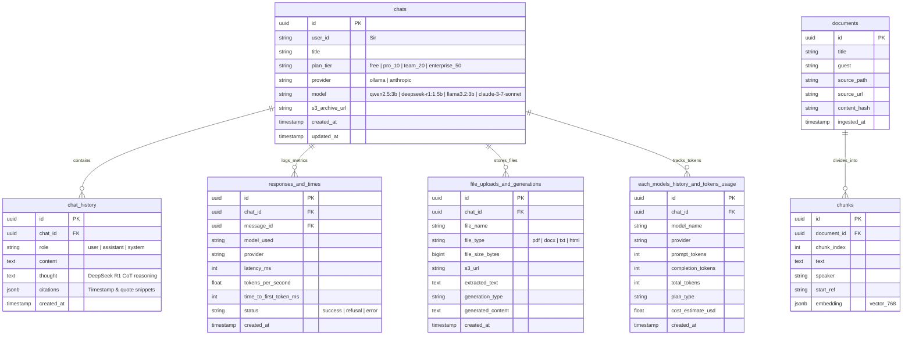

# System Architecture (architecture.md)
## The Lenny Growth Assistant

**Document Version:** 1.0.0  
**Stack:** FastAPI + PostgreSQL (pgvector) + React Three Fiber + Ollama / Claude  

---

## 1. High-Level Component Architecture

```
+--------------------------------------------------------------------------------------------------+
|                                    REACT FRONTEND (SPA)                                          |
|                                                                                                  |
|   [MindMerge UI Panels]   <--->  [SSE Streaming Client]   <--->  [Three.js 3D Background Engine] |
|   - Chat & Message List          - EventSource consumer           - R3F Canvas / WebGL           |
|   - Citations Drawer             - JSON chunk parser              - Mouse parallax loop          |
|   - Sandboxed Artifact Viewer    - Reconnect resilience           - Frameloop="demand"           |
+--------------------------------------------------------------------------------------------------+
                                               ▲
                                               │ HTTP / Server-Sent Events (SSE)
                                               ▼
+--------------------------------------------------------------------------------------------------+
|                                    FASTAPI BACKEND                                               |
|                                                                                                  |
|   [API Layer]                    [Agent Orchestrator]             [LLM Provider Layer]          |
|   - /sessions, /messages (SSE)   - Deterministic Router           - BaseLLMProvider Interface   |
|   - /artifacts, /config          - Question Path (RAG)            - OllamaProvider (Local)      |
|   - /health/db, /health/llm      - Ship 30 Skill + Validator      - AnthropicProvider (Cloud)   |
|   - Structured Error Middleware  - Artifact Generator             - OpenAIProvider (Cloud)      |
|                                                                                                  |
|   [Retrieval Engine]             [Data Ingestion Pipeline]        [Security Subsystem]          |
|   - Query Embedder (nomic-embed) - Transcript MD Parser           - Sandboxed iframe srcdoc     |
|   - Hybrid Search (Vector + FTS) - Speaker-Turn Chunking          - Strict Content Security Pol |
|   - Reciprocal Rank Fusion (RRF) - Content Hash Idempotency       - DOMPurify & rehype-sanitize |
+--------------------------------------------------------------------------------------------------+
                                               ▲
                                               │ SQLAlchemy 2.0 (Async) + asyncpg
                                               ▼
+--------------------------------------------------------------------------------------------------+
|                                    POSTGRESQL 16 + pgvector                                      |
|                                                                                                  |
|   [Conversational Persistence]                   [Vector & Full-Text Knowledge Base]             |
|   - users (id, metadata)                         - documents (id, title, guest, url, hash)       |
|   - sessions (id, user_id, title, model)         - chunks (id, doc_id, text, speaker, timestamp) |
|   - messages (id, role, citations, latency)      - chunks.embedding (VECTOR(768))                |
|   - artifacts (id, session_id, type, html)       - chunks.tsv (TSVECTOR)                         |
+--------------------------------------------------------------------------------------------------+
```

---

## 2. Database Schema (PostgreSQL 16 + pgvector)



---

## 3. Ingestion & Hybrid Retrieval Flow

### 3.1 Transcript Ingestion
1. **Source:** `ChatPRD/lennys-podcast-transcripts` repository (300+ episodes).
2. **Metadata Extraction:** Frontmatter parsed for `guest`, `title`, `youtube_url`, `publish_date`, and `keywords`.
3. **Chunking Strategy:** 
   * Segmented by speaker turns and timestamp boundaries (`300–600 tokens` per chunk).
   * Context overlap of 50 tokens to preserve conversational continuity.
   * Speaker attribution (e.g., `Lenny` vs. `Adam Fishman`) and time offset (e.g., `00:14:22`) attached to each chunk.
4. **Idempotent Upsert:** MD5 hash of raw file content stored in `documents.content_hash`. Unchanged episodes are skipped on re-indexing.

### 3.2 Hybrid Search & Reciprocal Rank Fusion (RRF)
To prevent failure modes where vector search misses exact names or acronyms (e.g., "PMF", "CAC", "Reforge", "Elena Verna") and keyword search misses semantic synonyms, we combine PostgreSQL Full-Text Search with Vector Search using **Reciprocal Rank Fusion (RRF)**:

$$\text{RRF Score}(d) = \frac{1}{k + \text{Rank}_{\text{vector}}(d)} + \frac{1}{k + \text{Rank}_{\text{FTS}}(d)}$$

Where constant $k = 60$.

* **Vector Search:** `chunks.embedding <=> query_embedding` using cosine distance.
* **Full-Text Search:** `chunks.tsv @@ websearch_to_tsquery('english', query)` using `ts_rank_cd`.
* **Relevance Threshold:** If $\max(\text{RRF Score}) < \text{THRESHOLD}_{\text{MIN}}$, the router branches to **Refusal Mode** without calling generative completion, ensuring zero hallucinations.

---

## 4. Agent Routing & Skill Architecture

Every user prompt undergoes intent classification via the deterministic Agent Router:

```
                            [User Prompt]
                                  │
                                  ▼
                        [Intent Classification]
                                  │
         ┌────────────────────────┼────────────────────────┐
         ▼                        ▼                        ▼
  [Question Path]          [Ship 30 Skill]          [Artifact Path]
         │                        │                        │
  - Hybrid RAG             - Hybrid RAG             - Context Gathering
  - Score Threshold Check  - Ship 30 Principles:    - HTML/CSS or MD Gen
  - Grounded Synthesis     * Compelling Hook        - Persist to DB
  - Extract Citations      * Skimmable Format       - Render in Viewer
  - SSE Token Stream       * 1,250-Word Target             │
         │                 * Specific Takeaway             ▼
         │                 - Post-Val Validation    [Sandboxed iframe]
         │                        │
         └────────────────────────┴────────────────────────┘
                                  │
                                  ▼
                         [SSE Token Stream]
```

---

## 5. Security & Artifact Sandboxing Matrix

Generated HTML and Markdown artifacts are strictly treated as **untrusted user input**:

| Security Domain | Permitted | Blocked / Sanitized | Rationale |
|---|---|---|---|
| **Iframe Sandbox** | `sandbox="allow-scripts"` | `allow-same-origin`, `allow-top-navigation`, `allow-popups`, `allow-forms`, `allow-downloads-without-user-activation` | Prevents generated code from accessing parent cookies, `localStorage`, session tokens, or hijacking browser navigation. |
| **Content Security Policy (CSP)** | Inline CSS, inline SVG, local data URIs | External script tags (`<script src="...">`), network `fetch()` / `XMLHttpRequest`, external WebSocket connections | Completely prevents Data Exfiltration and Cross-Site Scripting (XSS). |
| **DOM Sanitization** | Standard semantic HTML (`div`, `span`, `p`, `table`, `code`) | `<script>` tags, `javascript:` pseudoprotocols, `onerror`/`onload` attributes | DOMPurify strips active exploit payloads before injection into `srcdoc`. |
| **Markdown** | Standard GFM syntax (headings, tables, bold, lists) | Raw embedded malicious tags sanitized via `rehype-sanitize` | Safe rendering of markdown documents in chat thread. |

---

## 6. Flexible Model Switcher & Fallback

* **Environment Controls:**
  * `LLM_PROVIDER`: `ollama` (default local), `anthropic`, `openai`
  * `LLM_MODEL`: e.g., `qwen2.5:3b`, `llama3.2:3b`, `deepseek-r1:1.5b`, `claude-3-5-sonnet-20241022`
  * `EMBEDDING_MODEL`: `nomic-embed-text`
* **Fallback Cascade:**
  1. If `LLM_PROVIDER=anthropic` but `ANTHROPIC_API_KEY` is missing or invalid $\to$ automatic fallback to local Ollama with visible UI alert.
  2. If Ollama daemon is unreachable $\to$ API returns structured error `OLLAMA_SERVICE_UNAVAILABLE` with clear diagnostic hints.
